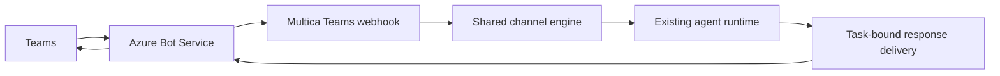

# Microsoft Teams integration

Status: implementation specification; the integration is not implemented yet.

Source baseline: `6ccbdd178ac7dcaf970acfc9a3836be2ca864c49`.
See the [implementation plan](../development/teams-implementation-plan.md) and
[gateway handoff](../development/microsoft-gateways.md).

## Purpose and scope

Expose a Multica agent as a Microsoft Teams bot. A workspace administrator brings
an Azure Bot registration, connects it to an agent, and installs the generated
Teams app. Members can ask questions, create issues and receive responses without
leaving their Teams conversation.

The adapter is reusable across workspaces and organizations. No tenant, mailbox,
person, project, agent role, model provider or hosting vendor is hard-coded. Each
installation has its own identity and credentials. Initial support targets Azure
Public Cloud and tenant-bound bot registrations; different installations may use
different tenants. This does not implement one hosted OAuth app serving arbitrary
customer tenants.

V1 supports text in personal chats, group chats and standard channel threads,
explicit bot mentions in group/channel conversations, and the existing `/issue`,
`/new` and `/clear` text commands. It delivers final responses and error notices.
It includes installation, account binding, disconnect and app-package download.

Files, images, Adaptive Cards, streaming edits, meetings, private/shared channels,
sovereign clouds, managed identity, Outlook.com and approval callbacks are outside
v1. A normal follow-up is a new turn in the same Multica Chat; it does not resume
a paused tool approval. General issue-event notifications and initiating new
Teams conversations are separate features.

## Architecture

Implement a Go adapter in `server/internal/integrations/teams`. Reuse `channel`,
`engine.Router`, `engine.NewChatSession`, shared channel tables and existing
permission checks. Do not add an orchestrator, model invocation, process or queue
solely to relay messages. Microsoft documents SDK-independent Connector REST;
the archived Bot Framework SDK must not become a new dependency.

A TypeScript service using the supported Teams SDK is an alternative, but adds a
second runtime and internal interface. Use it only if the initial Go protocol
validation demonstrates a concrete blocker, and revise this specification first.

The webhook is an HTTP transport, not a polling loop. Register the adapter and
resolver set using existing boot patterns. A passive channel lifecycle may block
until its context is cancelled; webhook acceptance must not depend on a process
owning an unrelated persistent-connection lease.

## Installation and API contract

Use `channel_type = "teams"`. Store non-secret `app_id`, `tenant_id` and display
metadata in `channel_installation.config`; store only encrypted client-secret
material there. Gate the integration on a valid `MULTICA_TEAMS_SECRET_KEY` using
the existing secretbox utility. An absent or invalid key disables installation.

One bot app belongs to one active agent installation, globally enforced through
the existing `(channel_type, config->>'app_id')` ownership rules. An agent has at
most one Teams installation in a workspace. Reject cross-workspace bot capture;
follow existing explicit revoke/reclaim rules for archived or removed owners.
Verify credentials against the configured tenant before saving them. A successful
token request does not prove that the Teams channel or manifest is configured;
show connection configuration separately from receipt of a verified activity.

| Endpoint | Access and behavior |
| --- | --- |
| `GET /api/workspaces/{id}/teams/installations` | Workspace members; public installation metadata and `configured`, `install_supported` flags only |
| `POST /api/workspaces/{id}/teams/install?agent_id=...` | Owner/admin; `{app_id, tenant_id, client_secret, display_name}`; validate workspace/agent ownership and verify credentials |
| `DELETE /api/workspaces/{id}/teams/installations/{installationId}` | Owner/admin; revoke installation and invalidate cached credentials |
| `GET /api/workspaces/{id}/teams/installations/{installationId}/app-package` | Owner/admin; download manifest and icons as ZIP, never credentials |
| `POST /api/teams/binding/redeem` | Authenticated Multica user; redeem `{token}` with membership and identity-conflict checks |
| `POST /api/webhooks/teams/{appID}` | Connector-authenticated; the path selects a candidate installation, never authorizes a request |

Public installation responses contain IDs, agent/workspace IDs, display name,
tenant/app IDs, status and timestamps. They exclude plaintext and encrypted
credentials. Input validation, error codes, response schemas and permissive
parsing for older desktop clients follow repository conventions. A credential
replacement uses the install endpoint for the existing owner, preserves account
and session bindings, and expires the previous credential/token cache.

## Transport and identity boundary

Before a message reaches the shared engine:

1. Limit the request body to 1 MiB and require JSON Activity input.
2. Resolve the candidate bot from the normalized route app ID. Load only that
   installation. Unknown/revoked installations do not accept messages.
3. Validate the bearer JWT with Microsoft's fixed Public Cloud OIDC/JWK source:
   allowed signing algorithm, signature, key/channel endorsement, issuer,
   audience for the selected app, and token lifetime. Never obtain signing keys
   from a URL supplied in the token or Activity.
4. Require `channelId == "msteams"`; validate the recipient bot identity, the
   Activity tenant against the installation, and consistency of tenant fields.
   Tenant-bound app credentials do not replace Activity-level tenant checks.
5. Validate `serviceUrl` against the token's service-URL claim when required by
   the protocol and a fixed allowlist of supported Microsoft Connector endpoints.
   Reject redirects and untrusted destinations before sending bearer credentials.
6. Handle text `message` activities only. Acknowledge supported non-message
   lifecycle events without creating runs. Ignore self/bot messages, unsupported
   edits and deletions. Malformed message identities fail without a run.
7. Produce a verified internal envelope. No unverified Activity is persisted as
   an authorized sender or passed to routing.

Use tenant ID plus Entra object ID as the stable sender identity for v1. Missing
object IDs and guest/cross-tenant onboarding are not supported. Do not authorize
by display name, email address, arbitrary workspace header or matching text.
Map normalized messages to `channel.InboundMessage`; retain provider routing
coordinates only as adapter-owned metadata.

Account binding uses existing one-time token mechanics, with a 15-minute TTL and
atomic redemption. Mint and send personal binding links only in a personal bot
chat. An unbound group/channel user receives an instruction to open the bot
personally; never post their binding token publicly or initiate a DM implicitly.
After binding, recheck workspace membership and agent invocation rights on every
message. Binding does not create a workspace membership.

## Conversation mapping and commands

| Teams input | Multica isolation |
| --- | --- |
| Personal conversation | One Chat per installation, tenant and Teams conversation |
| Group chat | One shared Chat per installation, tenant and conversation |
| Channel thread | One Chat per installation, tenant, channel conversation and thread root |

Treat Teams conversation identifiers as opaque. Establish root and reply
coordinates from documented Activities and test fixtures; do not copy Slack's
string concatenation or parse undocumented `conversation.id` suffixes. Store the
actual Connector conversation/root separately from the session-isolation key.
Use an unambiguous encoded tuple for composite keys.

Only explicit mentions reach the engine in a group/channel. Strip only the
validated bot mention from command text, preserve mentions of other people, and
reuse shared command parsing. A top-level channel mention starts its own thread;
a later mention in that thread continues it. Mentions in other threads do not
share context. No automatic retrieval of channel history is promised.

Use Activity IDs for per-installation inbound deduplication. Replays, user edits,
typing events and delivery receipts must not create extra runs. Return an HTTP
success after the input has been classified/durably ingested; never wait for the
agent. Infrastructure failure returns a retriable non-success and must not
permanently mark an unprocessed input as delivered.

`/new` changes the Chat route, `/clear` changes visible context in the same Chat,
and `/issue` invokes existing issue creation. Set issue origin to `teams_chat` via
the repository's additive constraint-migration pattern; allocate migration
numbers at implementation time, not in this document.

## Reply delivery

Deliver only results originating from this adapter. Use task-bound delivery
snapshots, not the current mutable Chat route: a `/new` or a later message must
not redirect a previous task's reply. Persist the originating conversation,
thread root, activity reference and validated service URL needed for the reply.
Revocation and agent deletion block subsequent sends.

Support final text and concise terminal-failure notices. Split long output into
ordered messages, cap each serialized Activity below 24 KiB and preserve Unicode.
Acquire existing reply-delivery ownership per logical turn and record completed
chunks. Respect `Retry-After` for explicit throttling. Refresh expired credentials
without replaying an already accepted message. A timeout after send is an unknown
outcome, not proof of failure: do not blindly resend it. No exactly-once delivery
claim is made.

Validate basic concurrency and duplicate completion events even for one server.
The supported pilot topology is one backend instance; restarts can interrupt
in-flight delivery and do not promise recovery of every process-local event.
Multi-replica recovery needs a separately verified event/delivery design, not a
claim based solely on a database lease. Do not add a global outbox rewrite here.

## UI, documentation and deployment

Extend the current `ChannelConnectDialog`, `ChannelDisconnectDialog`,
`useMessagingChannels` and `AgentChannelsSection`. Settings remain the channel
overview; agent pages own connection management. Do not restore the removed
per-platform agent Integrations tab or invent another navigation flow.

Use shared views for web/desktop, core API schemas/query hooks, workspace-scoped
keys, realtime invalidation and existing owner/admin controls. Provide an
authenticated `/teams/bind` web route; reserve `teams` through the existing slug
generator. Supported translation files follow existing channel conventions.

Generate a schema-valid Teams app ZIP with `manifest.json`, required icons,
configured bot app ID and the `personal`, `groupChat`, `team` scopes. Public
operator settings provide app name, website, privacy and terms URLs; never embed
an organization's private details or imply Microsoft endorsement. Use the
current official manifest schema, record the selected version in implementation,
and validate the ZIP in tests.

The modified backend must be self-hosted for testing; a custom local daemon does
not add features to the official hosted backend. Use the managed development
environment and a development HTTPS tunnel for live Teams delivery. Build from
this fork after implementation; an upstream prebuilt installer will not include
unreleased changes. Production hosting, credentials, tenant policies and app
approval are runtime/operator settings, documented with placeholders only.

## Acceptance

- Two installations in different tenants cannot access each other's accounts,
  sessions, credentials or replies.
- Invalid JWTs, tenants, bot IDs and service URLs cannot enqueue work or leak a
  bearer token. No bind token appears in group/channel messages.
- Authorized DM and mention-driven group/thread roundtrips work; independent
  threads, replays and context boundaries behave as specified.
- `/issue` creates a traceable assigned issue, `/new` and `/clear` retain shared
  engine semantics, and revocation blocks further sends.
- UI install/bind/disconnect and malformed-response paths are covered; public
  responses and evidence contain no credential material.
- Unit, database, frontend and applicable integration checks pass before a live
  test is called verified. Live cloud changes require their own authorized task.

## References

- [Connector REST without an SDK](https://learn.microsoft.com/en-us/azure/bot-service/rest-api/bot-framework-rest-overview?view=azure-bot-service-4.0)
- [Connector authentication requirements](https://learn.microsoft.com/en-us/azure/bot-service/rest-api/bot-framework-rest-connector-authentication?view=azure-bot-service-4.0)
- [Supported Teams SDKs](https://microsoft.github.io/teams-sdk/teams/choosing-an-sdk/)
- [Bot Framework SDK archive notice](https://github.com/microsoft/botframework-sdk)
- [Channel and group conversations](https://learn.microsoft.com/en-us/microsoftteams/platform/bots/how-to/conversations/channel-and-group-conversations)
- [Local HTTPS testing](https://learn.microsoft.com/en-us/microsoft-365/agents-sdk/test-with-dev-tunnel)
